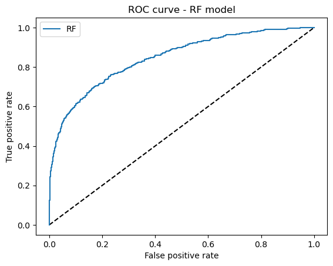
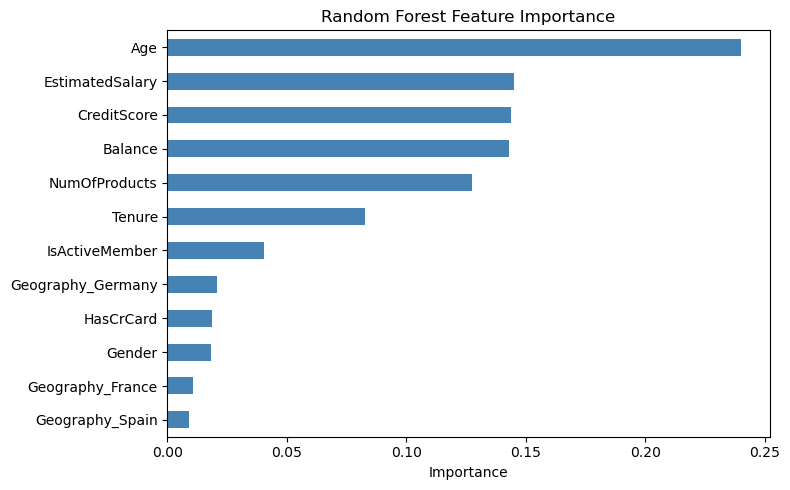
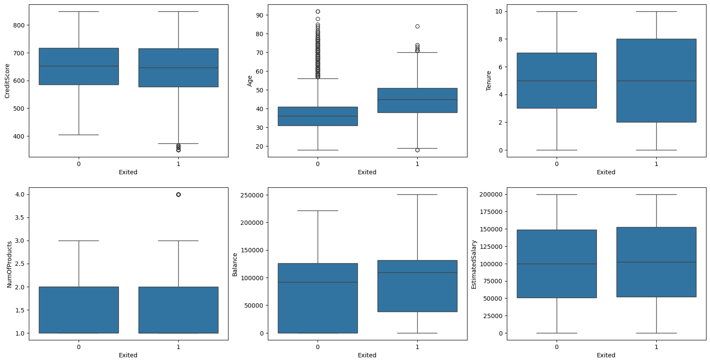
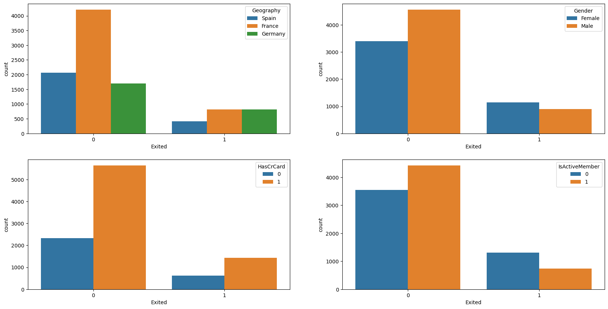

# Bank Customer Churn Prediction

Predicting which bank customers are likely to leave, and identifying the factors that drive churn, using supervised machine learning in Python (pandas, scikit-learn, seaborn).


## Business Problem

Acquiring a new customer costs far more than keeping an existing one. If a bank can flag customers who are at risk of leaving *before* they leave, it can target them with retention offers. This project builds classification models to predict churn and explains which customer attributes matter most.

## Dataset

[Predicting Churn for Bank Customers](https://www.kaggle.com/adammaus/predicting-churn-for-bank-customers) (Kaggle): 10,000 customers of a European bank.

| Feature | Description |
|---|---|
| `CreditScore` | Customer credit score |
| `Geography` | Country (France, Germany, Spain) |
| `Gender` | Male / Female |
| `Age` | Customer age |
| `Tenure` | Years as a customer |
| `Balance` | Account balance |
| `NumOfProducts` | Number of bank products held |
| `HasCrCard` | Has a credit card (1/0) |
| `IsActiveMember` | Active member (1/0) |
| `EstimatedSalary` | Estimated annual salary |
| **`Exited`** | **Target: churned (1) or retained (0)** |

The data has no missing values. About **20.4%** of customers churned, so the classes are imbalanced.

## Approach

1. **Exploratory data analysis**: distributions of numerical and categorical features split by churn status.
2. **Preprocessing**
   - Dropped identifier columns (`RowNumber`, `CustomerId`, `Surname`)
   - Stratified 75/25 train/test split to keep the churn ratio the same in both sets
   - One-hot encoding for `Geography`, ordinal encoding for `Gender`
   - Standardized numerical features (all encoders and scalers fit on the training set only, so no information leaks from the test set)
3. **Modeling**: Logistic Regression, K-Nearest Neighbors and Random Forest, each tuned with `GridSearchCV` (5-fold cross-validation)
4. **Evaluation**: accuracy, precision, recall (from the confusion matrix), ROC curve and AUC
5. **Interpretation**: L2 logistic regression coefficients and Random Forest feature importance

## Results

| Model | Best Hyperparameters | Accuracy | Precision | Recall | AUC |
|---|---|---|---|---|---|
| **Random Forest** | `max_depth=10`, `n_estimators=80` | **0.862** | **0.808** | **0.420** | **0.846** |
| K-Nearest Neighbors | `n_neighbors=9` | 0.843 | 0.728 | 0.363 | – |
| Logistic Regression | `penalty='l1'`, `C=1` | 0.809 | 0.596 | 0.194 | 0.772 |

**Random Forest performs best on every metric.** When it flags a customer as likely to churn, it is right about 81% of the time.

<p align="center">
  
</p>

## Key Insights

<p align="center">
  
</p>

- **Age is the strongest churn driver.** Churned customers have a median age of 45, compared with 36 for retained customers.
- **Engagement matters.** Inactive members churn at nearly twice the rate of active members (26.9% vs. 14.3%).
- **Germany is a high-risk market.** German customers churn at 32.4%, about double the rate in France (16.2%) and Spain (16.7%).
- **Gender gap.** Female customers churn more often than male customers (25.1% vs. 16.5%).
- **Product count has a non-linear effect.** Customers with 2 products have the lowest churn (7.6%), while those with 3–4 products churn at very high rates. This suggests that pushing more products onto a customer is not a retention strategy in itself.

<details>
<summary>Exploratory plots</summary>

**Numerical features vs. churn**


**Categorical features vs. churn**


</details>

## Business Recommendations

- Focus retention campaigns on **customers aged 40+** and on **inactive members**, for example with re-engagement offers and personalized outreach.
- Investigate the **German market** to understand what drives its higher churn (pricing, competition, service quality).
- Review the cross-selling strategy for customers holding **3 or more products**.

## Next Steps

- **Improve recall:** the best model still misses ~58% of churners. Options include tuning the decision threshold, `class_weight='balanced'`, or resampling (e.g. SMOTE).
- Try gradient-boosting models (XGBoost, LightGBM).
- Use SHAP values for customer-level explanations.

## Project Structure

```
├── churn_prediction.ipynb   # Full analysis: EDA, preprocessing, modeling, evaluation
├── data/
│   └── bank.data.csv        # Raw dataset
├── images/                  # Charts used in this README
└── requirements.txt
```

## How to Run

```bash
git clone https://github.com/CooperNing/Bank-Customer-Churn-Prediction.git
cd Bank-Customer-Churn-Prediction
pip install -r requirements.txt
jupyter notebook churn_prediction.ipynb
```
